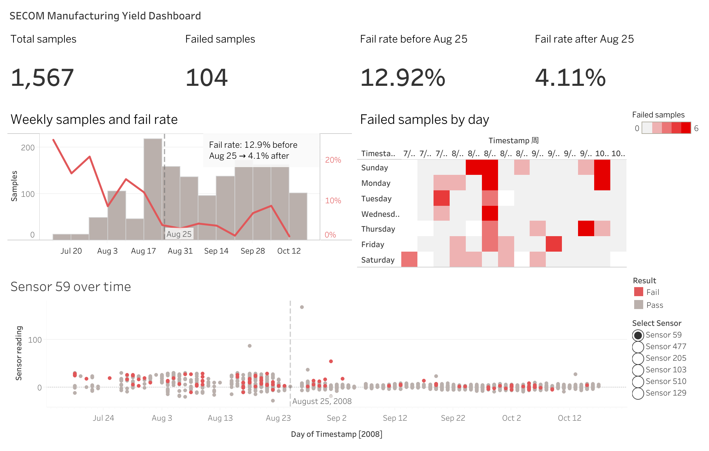

# SECOM Manufacturing Yield Dashboard

An interactive Tableau dashboard on the SECOM semiconductor dataset: how the fail rate
changed over time, and which sensors look different when a sample fails.

**[View the live dashboard on Tableau Public](YOUR_TABLEAU_LINK)**

## What the dashboard shows

- **Fail rate over time.** 104 of 1,567 samples failed (6.6%). The weekly fail rate was
  high in July and early August and dropped later. Before Aug 25 it was 12.9%, after that 4.1%.
  Bars show how many samples there were each week, because the first few weeks have very few
  samples and their fail rate is not reliable.
- **Failures by day.** A calendar heatmap of failed samples. Most of them cluster in a few days
  instead of spreading evenly.
- **Sensor readings over time.** Pick one of six sensors from the list. Red dots are failed
  samples. Some sensors clearly change level around Aug 25, which is the same time the fail
  rate drops.

**How to use it:** choose a sensor with the list on the right, click a week in the first chart
to focus the sensor chart on that week, and use the filter to look at the early or the late period.

## Why these six sensors?

SECOM has 590 sensors (446 after cleaning), which is too many for one dashboard.
I picked 6, and the choice is meant to tell one story, not to be a complete ranking.

In my [SECOM analysis project](https://github.com/yuning777/secom-process-analysis) I tested every sensor for a difference
between passed and failed samples. Most failures happened in the first weeks, and many
sensors also drift over time, so I tested again after removing the slow drift from each sensor.

- **sensor_59, sensor_477, sensor_205**: still differ between pass and fail after removing the
  drift. They were the top 3 in that test, but the signal is weak (AUC about 0.61).
- **sensor_103, sensor_510, sensor_129**: ranked in the top 10 before removing the drift, but fell
  to rank 57-78 after. They look related to failure mostly because they drift over time,
  and failures were more common early on.

Switching between them in the dashboard shows the difference. Other sensors, like
sensor_341 and sensor_336, were almost as good as the top 3, so this is a choice for the
story, not proof that only these six matter.

## Things to keep in mind

- I chose Aug 25 as the cutoff after looking at the weekly fail rate chart, so the 12.9% vs 4.1%
  comparison describes the data I already saw. It is not a tested prediction.
- I do not know why the fail rate dropped. It could be a process change, different products,
  or a change in how samples were checked.
- Nothing here shows that a sensor causes a failure.
- Missing sensor values are left empty (Tableau shows them as nulls).

## Data and files

- Data: [SECOM dataset, UCI Machine Learning Repository](https://archive.ics.uci.edu/dataset/179/secom), CC BY 4.0.
- `data/secom_clean.csv` comes from my SECOM analysis project. There I dropped 116 sensors with
  the same value in every sample and 28 sensors missing more than half of their values.
- `notebooks/01_prepare_dashboard_data.ipynb` selects the six sensors, adds the columns used by
  Tableau (`result`, `is_fail`, `date`, `period`) and saves `data/processed/secom_dashboard.csv`.
- Built with Python (pandas) and Tableau Public.